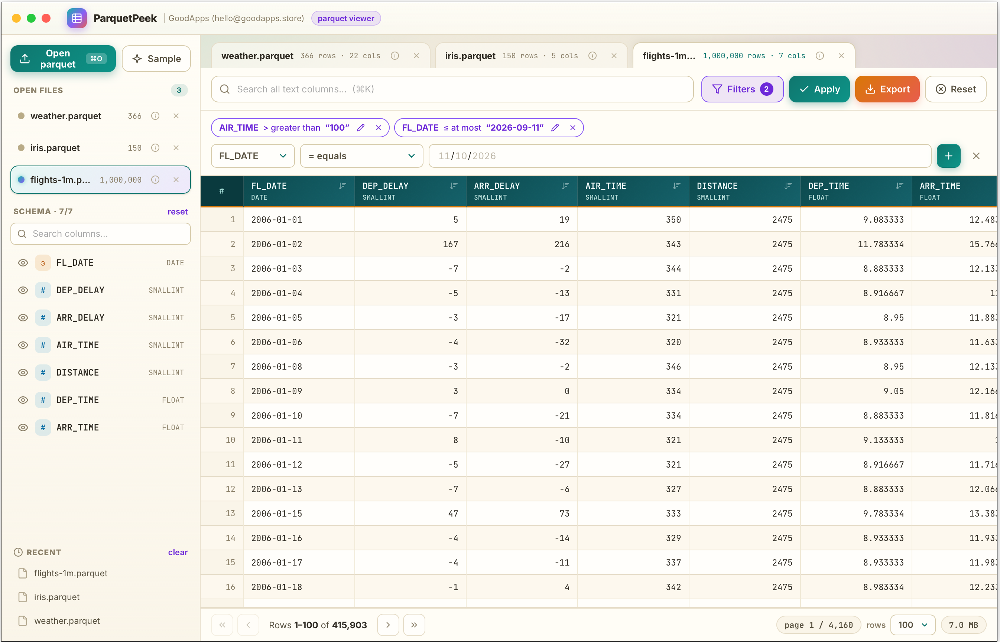
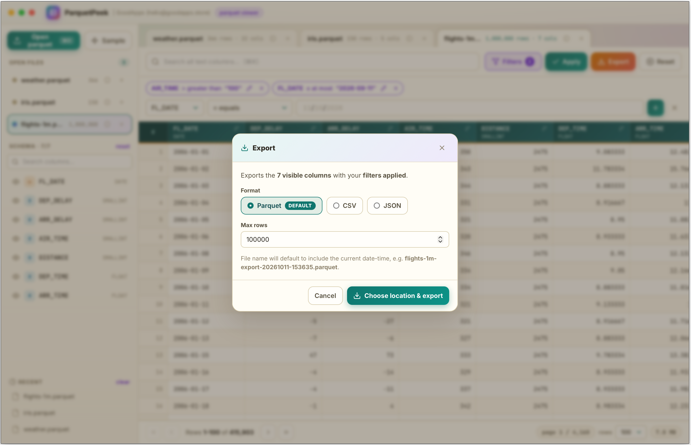

# ParquetPeek — Beautiful Parquet Viewer

A fast, beautiful desktop viewer for **Apache Parquet** files built with **Rust**, **Tauri 2**, and TypeScript.

## Screenshots

### ParquetPeek with filters applied



### ParquetPeek export options



## Highlights

* 📂 **Open any `.parquet` / `.pq` file** via dialog, drag & drop, recent-files list, or tabs for multiple files side by side.
* 🚀 **Large-file friendly**: only the visible page is loaded at a time with `LIMIT`/`OFFSET` pagination.
* 🧱 **Schema sidebar** with type icons, column search, and one-click show/hide per column (column order preserved).
* 🔎 **Quick search** across all text columns + a **filter builder** (`=`, `≠`, `>`, `<`, `≥`, `≤`, contains, does not contain, starts/ends with, is empty / is not empty).
* 🎛️ **Type-aware filters**: number/date/time inputs, boolean choices, and complete low-cardinality dropdowns (up to 15 distinct values), with validation before adding a filter.
* ↕️ **Click-to-sort** any column (asc → desc → off).
* 📊 **Column details**: filled/empty/distinct counts, min/max, and top values — click a value to filter to it.
* 🧾 **Row viewer**: side panel with copy-value buttons, expandable JSON trees for structs/lists/maps, and copy-row-as-JSON that preserves nested values and large integer digits. Large trees load 100 children at a time.
  Non-finite floats in nested values copy as strings (`"NaN"`, `"Infinity"`, `"-Infinity"`) to keep the copied JSON valid.
* 📤 **CSV export** of the current view (visible columns + filters + sort) with row cap and reveal/open after export.
* ℹ️ **File details**: size, row count and column count.
* ✨ **Sample generator**: creates a 1,500-row demo parquet file so you can explore without one.
* 🎨 **Warm Paper & Lagoon theme**: soft mid-tone paper surfaces with lagoon teal, plum, coral, and honey accents — frameless window with macOS traffic lights.

## Architecture & Tech Stack

| Layer | Technologies |
|---|---|
| **Frontend** | TypeScript, Vite 7 (no framework, event-delegated render) |
| **Desktop Shell** | Tauri 2 (`@tauri-apps/api`, `dialog`, `opener`, `clipboard-manager` plugins) |
| **Backend** | Rust 2021 |
| **File metadata** | `parquet` crate |
| **Sample writer** | `arrow-array` + `parquet` ArrowWriter |

## Getting Started

### Prerequisites

- [Node.js](https://nodejs.org/) (v20+ recommended) & `npm`
- [Rust](https://rustup.rs/) (1.77.2+)

### Installation & Development

1. Install frontend dependencies:
   ```bash
   npm install
   ```

2. Run in development mode (fast DuckDB via prebuilt static libs):
   ```bash
   npm run tauri:dev
   ```

3. Type-check and verify both frontend and Rust backend:
   ```bash
   npm run check
   ```

4. Build production frontend assets:
   ```bash
   npm run build
   ```

5. Build desktop bundle for your platform:
   ```bash
   npm run tauri:build
   ```

## DuckDB builds (fast by default)

| Command | What it does |
|---|---|
| `npm run tauri:dev` | Dev app, DuckDB linked from prebuilt statics (~80s first build, ~9s incremental) |
| `npm run tauri:build` | Local installable, single static binary (no extra dylib to ship) |
| `npm run check` | `tsc` + `cargo check` with the same DuckDB env |
| `npm run tauri …` | Extra args forwarded to the Tauri CLI through the same DuckDB env (e.g. `npm run tauri build` ≡ `npm run tauri:build`) |

- **Why not `bundled`:** compiling DuckDB from source costs 10–15 min + GBs of `.o` files per clean build. `duckdb` is therefore declared with `default-features = false` and **no** `bundled`/`json`/`parquet` in `src-tauri/Cargo.toml`. Trap to avoid: `json`/`parquet` features imply `bundled`, and `DUCKDB_DOWNLOAD_LIB=1` is silently ignored whenever `bundled` is on. (`frozen-duckdb@0.1.0` was evaluated and rejected: published crate ships no binaries and still forces a bundled compile.)
- **How it works:** `scripts/with-duckdb.mjs` runs `scripts/fetch-duckdb.mjs`, which reads the resolved DuckDB version from `src-tauri/Cargo.lock`, downloads the matching `static-libs-*` archive from official DuckDB GitHub Releases into gitignored `src-tauri/libs/<rust-triple>/` (~125MB, idempotent via `.fetch-ok` marker, offline-safe after first fetch), then exports `DUCKDB_LIB_DIR` + `DUCKDB_STATIC=1`. `src-tauri/build.rs` links the whole archive set (extensions + loader first) plus system libs (`c++` macOS; `stdc++/pthread/dl/m` Linux). Pre-set `DUCKDB_LIB_DIR` is respected; `DUCKDB_TRIPLE` overrides host detection. The fetch also writes gitignored `.cargo/config.toml` with the same two keys (cargo discovers it from any working directory at or below the repo root), so bare `cargo build` / `npx tauri …` invocations link without the wrapper after the first fetch (explicitly exported variables still win).
- **Feature parity:** archives bundle parquet + json statically, so `read_parquet`, `to_json`, `COPY … FORMAT PARQUET/JSON/CSV`, `DESCRIBE`, `COUNT(*)` all work with zero runtime extension downloads. Verified binary is fully static (`otool -L` shows system frameworks only).
- **Windows exception:** official static archives are MinGW-only and won't link under MSVC, so Windows builds compile from source: `tauri build --features source-bundled`. Handled automatically in CI.
- **Releases:** push a `v*` tag → `.github/workflows/release.yml` (same shape as serverbox: draft release → 6-target matrix → publish) builds per-OS/arch bundles (`ParquetPeek-v[version]-…` assets). macOS/Linux link prebuilt statics; Windows uses `source-bundled`.
- **Disk hygiene:** `src-tauri/target/` + `src-tauri/libs/` are gitignored. Reclaim GBs anytime with `cargo clean --manifest-path src-tauri/Cargo.toml`; next build re-links from staged archives (no re-download).
- **If a link ever fails** (e.g. new DuckDB archive layout on Linux, which is configured but CI-unproven): build that target with `--features source-bundled` as the fallback; `cargo update -p duckdb` auto-fetches matching archives on next build.

**Notes**

- The main window is configured with `"visible": false` and shown by the backend after fitting it to the work area, so always launch via `tauri dev` / the built bundle.
- App icons live in `src-tauri/icons/` (generated via `npx tauri icon icon.svg`).

## Backend commands (Tauri `invoke`)

| Command | Purpose |
|---|---|
| `open_dataset(path)` | Schema, row count, file metadata |
| `fetch_page(args)` | One page: selected columns + filters + quick search + sort |
| `column_profile(path, column)` | Null/distinct counts, min/max, top-15 values |
| `export_csv(args)` | Filtered/sorted export to CSV |
| `generate_sample(destination)` | Write + open a 1,500-row demo file |
| `reveal_path(path)` | Show file in system file manager |
| `open_external(path)` | Open file with the default app |
| `window_minimize/maximize/close` | Frameless window controls |

All identifiers are validated against the live schema allow-list and all literals escaped server-side; `LIMIT` is clamped to 1–1000 rows per page and exports to 10M rows.

## Shortcuts

| Keys | Action |
|---|---|
| `Cmd/Ctrl + O` | Open parquet file |
| `Cmd/Ctrl + K` | Focus quick search |
| `Enter` (in filter value) | Add filter |
| `Esc` | Close modal / drawer |

## License

MIT — see [LICENSE](LICENSE).

### Retry a missing tag-triggered release run

If a pushed version tag does not create a GitHub Actions run, manually dispatch
the release workflow with the existing tag:

```sh
gh workflow run release.yml --repo goodappsstore/parquet-viewer --ref main -f release_tag=v0.1.1
```

Replace `v0.1.1` with the intended existing tag. The workflow verifies that the
tag exists and checks out that tag for every native build.
